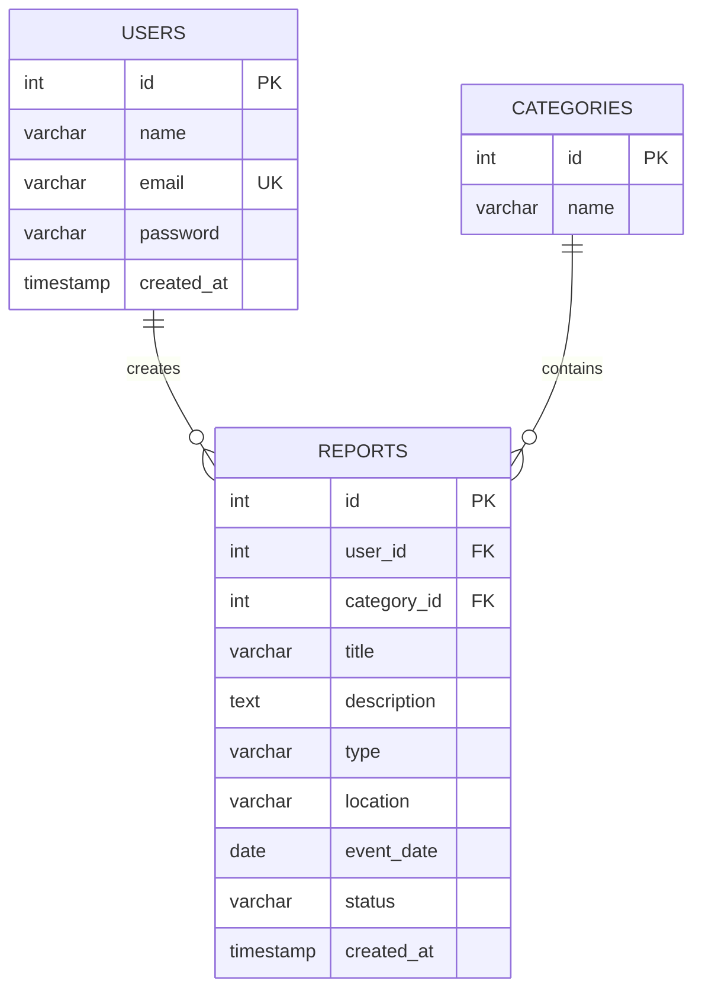

# QaytaTap — ER-диаграмма

## Мақсаты
Бұл диаграмма дерекқордың негізгі кестелері мен олардың байланысын көрсетеді.

## Кестелердің сипаттамасы

- **USERS** — пайдаланушылар туралы ақпарат.
- **CATEGORIES** — заттардың санаттары.
- **REPORTS** — жоғалған және табылған заттар туралы хабарландырулар.

## Байланыстар

- Бір пайдаланушы бірнеше хабарландыру жариялай алады.
- Бір санатта бірнеше хабарландыру болуы мүмкін.
- `user_id` — пайдаланушы кестесіне сілтеме.
- `category_id` — санаттар кестесіне сілтеме.

**PK** — негізгі кілт, **FK** — сыртқы кілт, **UK** — бірегей мән.
